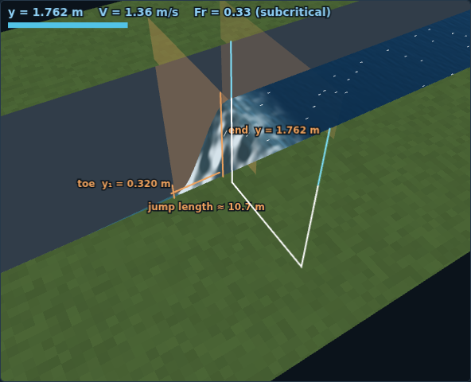
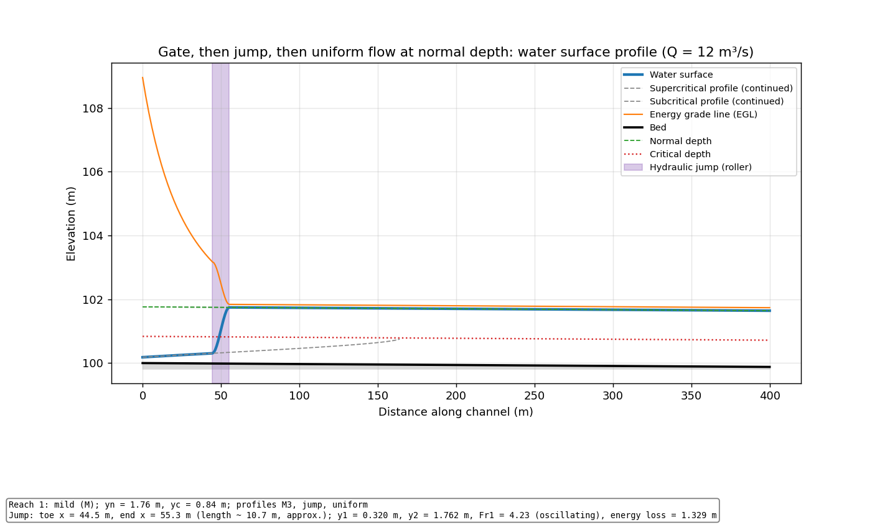

# Hydraulic Jump and Gradually Varied Flow Profiler

**[Open the web app](https://biswashk920.github.io/hydraulic-jump/)** (runs in the browser, nothing to install)



A tool for computing water surface profiles in open channels. Give it a discharge and a channel made of one or more reaches, and it finds the normal and critical depth of each reach, classifies the profile (M1, M2, M3, S1, S2, S3, C1, C3, H2, H3, A2, A3), computes the profile with the standard step method, and locates any hydraulic jump together with its sequent depth, length and energy loss.

There are two versions that use the same method:

| Version | Location | Use |
|---|---|---|
| Web app | `docs/index.html` | Single HTML file with a 3D view, figures and a station table. Works offline. |
| Python package | `gvf/` | Command line, CSV and PNG output, tests and validation. |

## Web app

- 3D view of the channel and water (WebGL): jump close-up, whole channel, top, side and front views, and a camera that moves with the water. Vertical and width exaggeration can be adjusted, and the water can be coloured by Froude number or depth.
- The jump is drawn with a toe, a roller of computed length, and the end of the roller. The depths before and after and the length are labelled.
- Figure 3 shows how the jump position is found (the momentum functions of the supercritical and subcritical profiles cross at the toe), with the calculation written out for the current channel.
- Longitudinal profile, Froude number, specific energy and momentum diagrams, cross-section panel, station table and CSV export.
- Ten example channels, and a form for any number of reaches (rectangular, trapezoidal or circular).



## Running the Python version

Windows, Anaconda Prompt:

    cd path\to\hydraulic-jump
    pip install -r requirements.txt
    python -m gvf examples/gate_jump_uniform.json --egl

Results are written to `results/`: a station table (CSV), the profile and Froude number figures, and a text summary.

Options: `--out FOLDER`, `--Q`, `--step`, `--tol`, `--start-z`, `--up`, `--down`, `--egl`, `--no-plots`.

To run the web app locally:

    cd docs
    python -m http.server 8000

then open http://localhost:8000.

## Channel description

JSON file, SI units, slope positive when the bed falls downstream (see `examples/`):

```json
{
  "name": "Gate, then jump, then uniform flow",
  "discharge": 12.0,
  "start_bed_elevation": 100.0,
  "step": 2.0,
  "tolerance": 1e-6,
  "upstream":   {"type": "gate", "opening": 0.3, "cc": 0.61},
  "downstream": {"type": "normal"},
  "reaches": [
    {"length": 400, "slope": 0.0003, "n": 0.013,
     "section": {"type": "rectangular", "width": 5}}
  ]
}
```

Sections: `rectangular` (`width`), `trapezoidal` (`width`, `side_slope` as horizontal per 1 vertical), `circular` (`diameter`). A CSV file with one row per reach can also be used (`examples/reaches_table.csv`, with `--Q`, `--up` and `--down` on the command line).

| Upstream `type` | Meaning |
|---|---|
| `normal` | depth of uniform flow in the first reach |
| `gate` | sluice gate with `opening` (m) and optional `cc` (default 0.61) |
| `critical` | critical depth, for a lake or reservoir inlet |
| `depth`, `level` | known depth or water surface elevation |
| `none` | no condition |

| Downstream `type` | Meaning |
|---|---|
| `normal` | depth of uniform flow in the last reach |
| `depth`, `level` | known tailwater depth or water surface elevation |
| `weir` | rectangular channels only, with `crest` height and `cw` (default 1.7) |
| `overfall` | free overfall, critical depth at the end |
| `none` | no condition |

## Method

Subcritical flow is computed upstream from its control and supercritical flow downstream, using the standard step method (energy equation, Manning friction, `scipy.optimize.brentq` on the correct side of critical depth). At a change from a flatter to a steeper reach, critical depth is the control. A hydraulic jump starts where the momentum function of the supercritical flow falls to that of the tailwater-controlled flow. The jump is drawn over a length L = 6.1 y2, and the flow then follows the subcritical profile.

All equations and the corresponding code are described in [`theory/THEORY.md`](theory/THEORY.md).

## Validation

Run `python -m gvf.validate` to repeat the checks (31 in total) or `python -m gvf.validate --write` to update [`theory/VALIDATION.md`](theory/VALIDATION.md) with the measured values. The checks compare the program with:

- closed-form results: normal and critical depth, E_min = 1.5 yc for a rectangle, the Bélanger sequent depth equation, the energy loss formula, equal momentum across a jump and equal energy at alternate depths, for rectangular, trapezoidal, triangular and circular sections;
- an independent solution of dy/dx = (S0 - Sf)/(1 - Fr^2) by adaptive Runge-Kutta integration, for M1, M2, M3, S2, S3, H2 and A2 profiles and for trapezoidal and circular sections, including a step-size convergence study;
- physical behaviour: approach to normal depth, the energy line never rising in the flow direction, and the jump moving downstream as the tailwater drops.

The unit tests are run with `python -m unittest discover -s tests -v`. They also check that the web app (which needs Node.js for this test) gives the same results as the Python package on every example.

Not validated against published data: the jump length rule, the jump classes by Froude number, the default weir coefficient and the gate contraction coefficient. These are empirical rules of thumb and should be checked against a textbook. The roller shape and the foam in the 3D view are illustrations. `examples/TEXTBOOK_EXAMPLE.md` explains how to add a worked example from a course textbook and compare it.

The web app was tested in Chromium only.

## Limitations

- Steady, one-dimensional, gradually varied flow.
- Prismatic reaches; no sediment, no side inflow, no losses at changes of cross-section.
- On a sloping bed the jump uses the horizontal-floor momentum equation.
- Circular sections are limited to 99 % of the diameter (no pressurised flow).
- A reach with critical slope is treated like a steep reach.
- A free overfall is simplified to critical depth at the last station.

## Repository layout

    README.md, LICENSE, .gitignore, requirements.txt
    gvf/        Python package
    docs/       index.html (web app, served by GitHub Pages)
    examples/   example channels, results/, TEXTBOOK_EXAMPLE.md
    theory/     THEORY.md and VALIDATION.md
    tests/      Python tests and the Node runner for the web app
    tools/      sync_presets.py (copies the examples into the web app)

After changing an example, run `python tools/sync_presets.py`.

## Author

Biswash Kaphle. Repository: https://github.com/biswashk920/hydraulic-jump

## License

MIT, see [LICENSE](LICENSE).